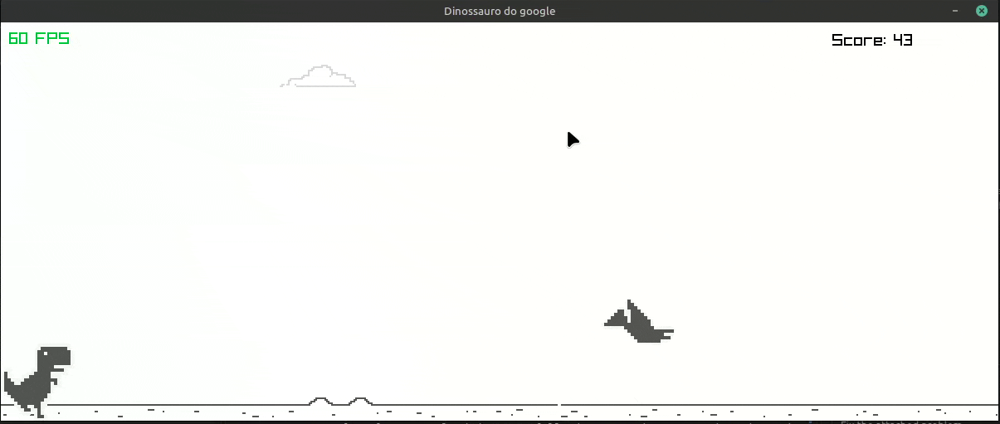

[readme.md](https://github.com/user-attachments/files/33644238/readme.md)
# Dino Runner

A Chrome Dino-inspired endless runner developed in **C# using Raylib-cs**.

Jump over cacti, duck under pterodactyls, and survive for as long as possible while trying to beat your high score. This project was created as a learning experience to practice object-oriented programming, game loops, collision detection, animation, and game state management.



## Description

Dino Runner is a small, offline endless-runner game inspired by the dinosaur game built into the Google Chrome browser. The original game can also be played [here](https://chromedino.com/).

- **Spacebar:** Jump
- **Down Arrow:** Duck

Obstacles approach from the right, and the game becomes faster as you pass them.

## Features

- Running, jumping, and ducking animations.
- Multiple cactus obstacles and pterodactyls.
- Random obstacle spawning.
- Collision detection.
- Scrolling background with a day-and-night cycle.
- Increasing difficulty as obstacles are passed.
- Score and high-score tracking.
- Game-over screen and restart functionality.

## Technologies

- C#
- .NET
- Raylib-cs
- Object-oriented programming

## Getting Started

### Prerequisites

- A compatible .NET SDK.
- Git, if you want to clone the repository.

### Installation

1. Clone the repository:

   ```bash
   git clone <https://github.com/OAtila/Dino-chrome.git>
   ```

2. Navigate to the project directory containing the `.csproj` file.

3. Run the game:

   ```bash
   dotnet run
   ```

Make sure the required graphics assets are present in their expected directories.

## Future Improvements

- Render the score using sprite-based digits.
- Add more obstacle variations.
- Start the game in a paused state and wait for player input.

## Assets

- [Chrome Dinosaur Game](https://chromedino.com/) — source/reference for the sprite sheet.
- Sounds was made using audacity


